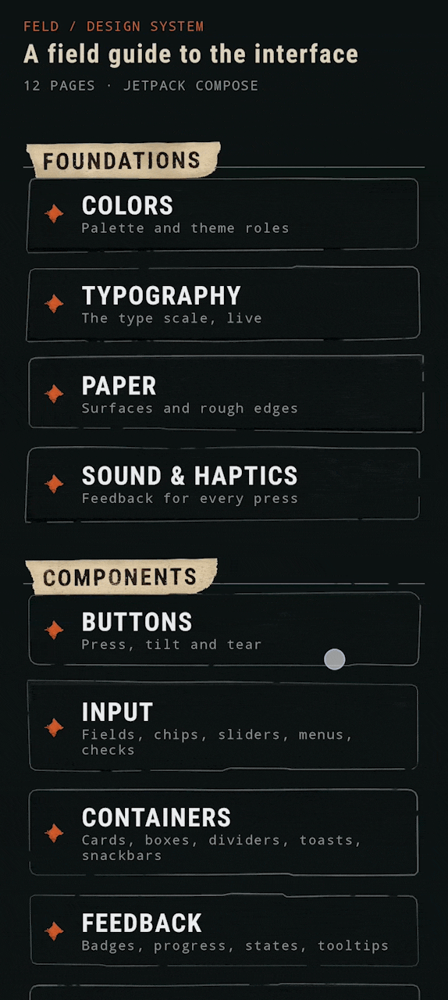

<p align="center">
  
</p>

<p align="center">
  <a href="https://github.com/dasdasr/feld-design/actions/workflows/ci.yml">
    
  </a>
  <a href="https://jitpack.io/#dasdasr/feld-design">
    
  </a>
  
  
  <a href="LICENSE">
    
  </a>
</p>

<p align="center">
  A Compose design system that looks like paper, tape and marker ink.<br>
  Procedural AGSL materials, 40+ components, 55 vector icons, sounds and haptics.<br>
  <b>No texture files.</b> Every surface is generated, and every one can be re-rolled with a seed.
</p>

<p align="center">
  <a href="https://github.com/dasdasr/feld-design/releases/latest"><b>Download catalog</b></a> ·
  <a href="#install">Install</a> ·
  <a href="#quick-start">Quick start</a> ·
  <a href="#used-in">Used in</a>
</p>

<p align="center">
  
</p>

## Install

```kotlin
// settings.gradle.kts
dependencyResolutionManagement {
    repositories {
        google()
        mavenCentral()
        maven("https://jitpack.io")
    }
}

// build.gradle.kts
dependencies {
    implementation("com.github.dasdasr:feld-design:0.2.3")
}
```

Needs `minSdk 24`, Kotlin with the Compose compiler plugin, and JDK 17.

## Quick start

```kotlin
setContent {
    FeldTheme {
        FeldWarmup() // once, next to the root theme

        ProvideSeedScope {
            AppNavGraph()
        }
    }
}
```

```kotlin
FeldCard(modifier = Modifier.fillMaxWidth(), onClick = { }) {
    Text("A card on paper", style = MaterialTheme.typography.titleMedium)
}

FeldButton(
    text = "Save scene",
    onClick = { },
    spec = FeldButtonDefaults.Orange,
)
```

<details>
<summary><b>Components</b></summary>

| Group          | What is in it                                                                                                                                                                       |
|----------------|-------------------------------------------------------------------------------------------------------------------------------------------------------------------------------------|
| **Buttons**    | `FeldButton`, `FeldTextButton`, `FeldIconButton`, `FeldGhostButton`, `FeldFilmButton`, `FeldFieldButton`, `FeldFab`, `FeldDialogActions`                                            |
| **Containers** | `FeldCard`, `FeldPaperBox`, `FeldNoteCard`, `FeldDialog`, `FeldDialogCard`, `FeldDivider`, `FeldTickRule`, `FeldSectionHeader`, `FeldToastHost`, `FeldSnackbar`, `FeldSnackbarHost` |
| **Input**      | `FeldTextField`, `FeldChip`, `FeldCheckbox`, `FeldRadioButton`, `FeldDropdown`, `FeldSwitch`, `FeldSlider`, `FeldSegmentedControl`, `FeldMenu`, `FeldColorSwatches`                 |
| **Navigation** | `FeldScreenHeader`, `FeldActionBar`, `FeldToolbar`                                                                                                                                  |
| **Feedback**   | `FeldBadge`, `FeldEmptyState`, `FeldLoadingState`, `FeldErrorState`, `FeldTooltip`                                                                                                  |
| **Progress**   | `FeldProgressIndicator`, `FeldCircularProgressIndicator`                                                                                                                            |
| **Content**    | `FeldIcon`, `FeldDistressedTitle`, `FeldTitleTag`, `FeldDiamond`, `FeldWornDiamond`, `FlatDiamond`                                                                                  |
| **Settings**   | `FeldSettingsSection`, `FeldSettingRow`, `FeldSettingValueRow`, `FeldSettingSwitchRow`, `FeldSettingsDivider`                                                                       |

Also public: `FeldTheme`, `FeldPalette`, 55 icons in `FeldIconId`, materials (`FeldPaper`,
`FeldMarker`, `FeldTape`),
`DecalLayer` (rulers, perforation strips, tape, stitches, staples, folded corners, tally counts),
`RoughShape`, `SeedBranch`, `FeldSounds`, `FeldHaptics`, `rememberFeldSnackbarState()`.

</details>

<details>
<summary><b>Textures and seeds</b></summary>

```kotlin
FeldPaperBox(
    modifier = Modifier.fillMaxWidth().height(100.dp),
    seed = 42,
    spec = FeldPaper.Note,
)
```

The same seed gives the same paper. A different seed gives a different sheet.
Pass `textured = false` to a surface that supports it to get flat drawing.

</details>

<details>
<summary><b>Warm-up</b></summary>

AGSL compiles on first use, which can cause a hitch on the first screen.
`FeldWarmup` pre-compiles shaders and pre-bakes chip textures in the background.

Put it **once**, next to the root theme, not per screen.

```kotlin
FeldWarmup(
    extraChipColors = listOf(
        Color(0xFFB03A2E),
        Color(0xFF2E86C1),
    )
)
```

</details>

<details>
<summary><b>Sound and haptics</b></summary>

Components never ship sounds. They call an interface, and your app decides what plays.

```kotlin
class AppSounds(private val player: SoundPlayer) : FeldSounds {
    override fun click(seed: Int) = player.play("click")
    override fun select() = player.play("select")
    override fun toggle(seed: Int) = player.play("toggle")
    override fun cancel() = player.play("cancel")
    override fun save() = player.play("save")
    override fun delete() = player.play("delete")
    override fun tab(seed: Int) = player.play("tab")
}

CompositionLocalProvider(LocalFeldSounds provides AppSounds(player)) {
    AppNavGraph()
}
```

</details>

<details>
<summary><b>Under the hood</b></summary>

- Surfaces are rendered once into a bitmap and cached with an LRU cache.
- Shaders are compiled ahead of time by `FeldWarmup`.
- Below API 33, layouts fall back to flat, shader-free drawing.
- `SeedBranch` keeps procedural textures deterministic across UI branches.
- `DecalLayer` adds reusable decorative details without baking them into texture assets.

Materials: paper, dry paper, worn surfaces, ink, accent, distress, marker film and sticker tape.

</details>

<details>
<summary><b>Catalog app</b></summary>

The `:catalog` module is a runnable field guide to the whole system.
[Download the APK](https://github.com/dasdasr/feld-design/releases/latest)

| Home                                   | Buttons                                      | Input                                    | Sound                                    |
|----------------------------------------|----------------------------------------------|------------------------------------------|------------------------------------------|
|  |  |  |  |

Every page has a live preview, controls for every parameter, variants, and a Code tab with Kotlin
generated from the current controls.

Pages: Colors, Typography, Paper, Sound & Haptics, Buttons, Input, Containers, Feedback, Navigation,
Content, Settings, Dialog.
The button in the header opens the Design Sheet, the scrollable board used for the screenshots
above.

</details>

<details>
<summary><b>Build and engineering</b></summary>

```bash
./gradlew :catalog:installDebug
./gradlew :designsystem:assembleRelease
./gradlew detekt lint test
```

- **CI:** GitHub Actions on push and PR: Detekt, Lint, tests, library release build, catalog build.
- **Releases:** push a tag such as `0.3.0`; JitPack publishes the library and a workflow attaches
  the catalog APK to a GitHub Release.
- **Explicit API mode**.
- **Resource prefix:** `feld_`.
- **Quality:** Detekt with ktlint wrapper, Lint with `abortOnError`.
- A sources jar is published with every release.

</details>

## Used in

<table align="center">
  <tr>
    <td width="360" align="center">
      
    </td>
    <td width="360" align="center">
      
    </td>
  </tr>
  <tr>
    <td align="center"><sub>DESIGN SYSTEM CATALOG</sub></td>
    <td align="center"><sub>FELD ELYSIUM</sub></td>
  </tr>
  <tr>
    <td align="center"><sub>Browse components, tweak variants and copy Kotlin code.</sub></td>
    <td align="center"><sub>A dialogue sandbox built with Feld Design.</sub></td>
  </tr>
</table>

**Status:** `0.x`. Used in production, but the API can still change between minor versions.

---

<sub>MIT License · <a href="NOTICE.md">Notice</a></sub>
