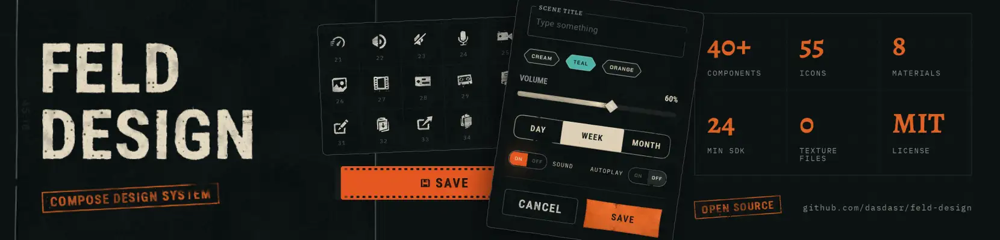
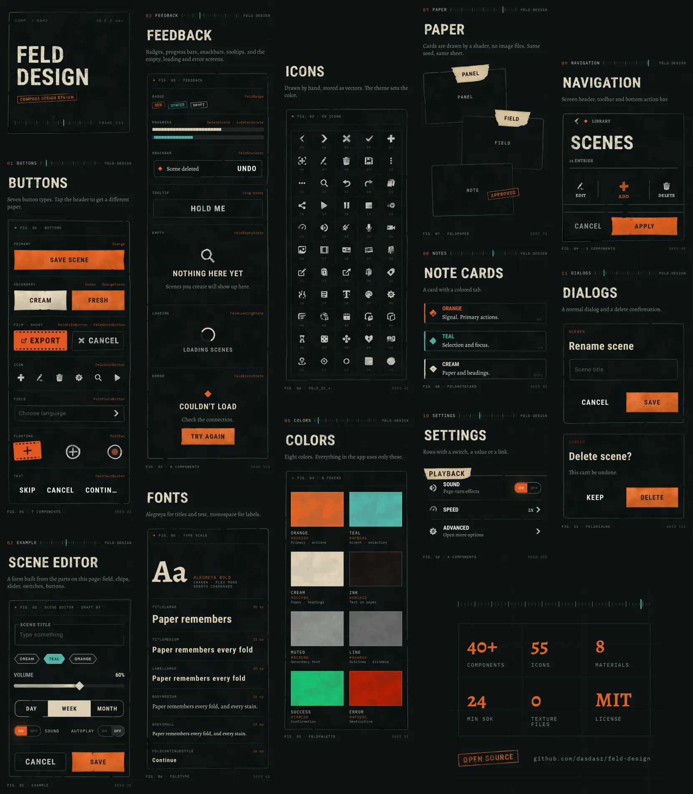
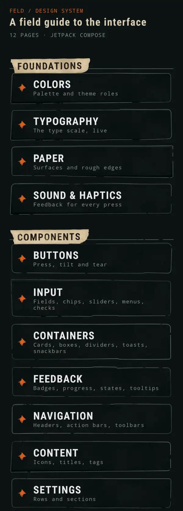
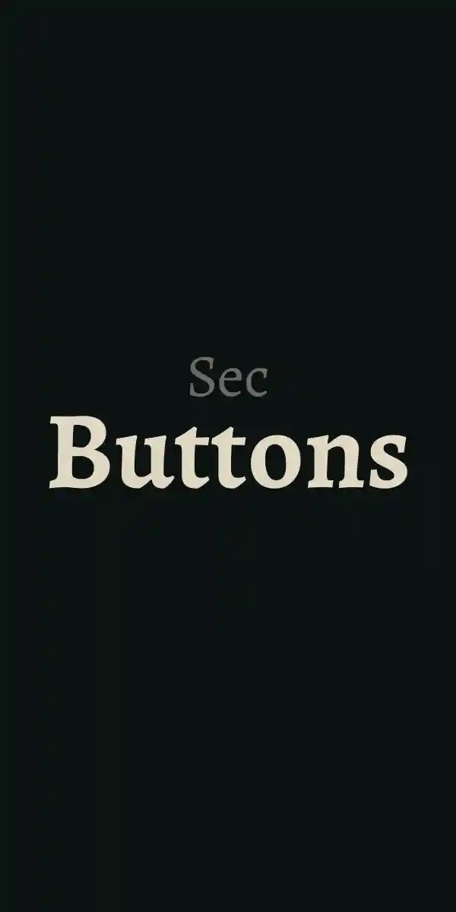
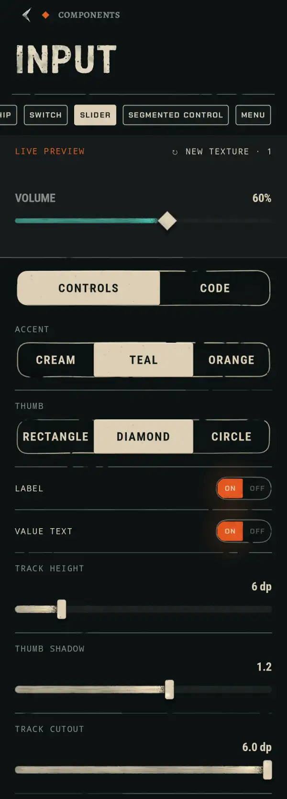
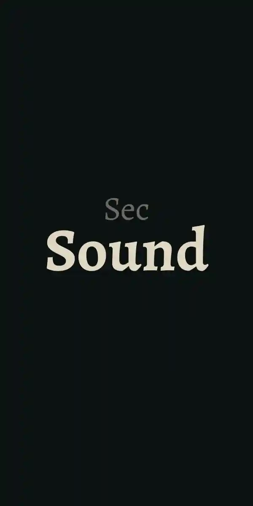

<p align="center">
  
</p>

<p align="center">
  <a href="https://github.com/dasdasr/feld-design/actions"></a>
  <a href="https://jitpack.io/#dasdasr/feld-design"></a>
  
  
  <a href="LICENSE"></a>
</p>

<p align="center">
  <a href="https://github.com/dasdasr/feld-design/releases/latest"><b>Download catalog</b></a> &nbsp;/&nbsp;
  <a href="#install">Install</a> &nbsp;/&nbsp;
  <a href="#quick-start">Quick start</a> &nbsp;/&nbsp;
  <a href="#components">Components</a> &nbsp;/&nbsp;
  <a href="#under-the-hood">Under the hood</a> &nbsp;/&nbsp;
  <a href="#catalog-app">Catalog app</a> &nbsp;/&nbsp;
  <a href="#build">Build</a>
</p>

<p align="center">
  A Compose design system with a worn-paper, marker and tape look.<br>
  Custom AGSL materials, 30+ components, sounds and haptics built in.
</p>

> [!NOTE]
> Extracted from [FeldElysium](https://github.com/dasdasr/FeldElysium), a dialogue sandbox for Android.

<p align="center">
  
</p>

<!-- TODO: demo gifs -->
<table align="center">
  <tr>
    <td></td>
    <td></td>
  </tr>
  <tr>
    <td align="center"><sub>TRY IT IN THE CATALOG</sub></td>
    <td align="center"><sub>SEE IT IN A REAL APP</sub></td>
  </tr>
</table>

## Why this exists

Most Compose libraries give you flat Material. This one gives you surfaces that look like physical
things: paper panels, sticky tape, marker ink, chalk icons, distressed titles. Every surface is
procedural, so there are no texture files to ship, and every one can be re-rolled with a seed.

It was built for one app and then pulled out, so the components are the ones a real app needed:
buttons, cards, dialogs, inputs, navigation, settings rows. Not a pile of experiments.

**Status:** `0.x`. It is used in production in FeldElysium, but the API can still change between
minor versions.

## Install

Published on [JitPack](https://jitpack.io/#dasdasr/feld-design).

```kotlin
// settings.gradle.kts
dependencyResolutionManagement {
    repositories {
        google()
        mavenCentral()
        maven("https://jitpack.io")
    }
}
```

```kotlin
// build.gradle.kts
dependencies {
    implementation("com.github.dasdasr:feld-design:0.2.1")
}
```

Needs `minSdk 24`, Kotlin with the Compose compiler plugin, and JDK 17. Compose and Material3 come
in as `api` through the Compose BOM, so you don't add them twice.

## Quick start

Wrap your content in the theme and use the components like any other Compose ones. This is the
setup FeldElysium uses:

```kotlin
setContent {
    FeldTheme {
        FeldWarmup() // once, high in the tree

        ProvideSeedScope {
            CompositionLocalProvider(LocalFeldSounds provides sounds) {
                AppNavGraph()
            }
        }
    }
}
```

```kotlin
FeldCard(
    modifier = Modifier.fillMaxWidth(),
    onClick = { },
) {
    Text("A card on paper", style = MaterialTheme.typography.titleMedium)
}

FeldButton(
    text = "Save scene",
    onClick = { },
    spec = FeldButtonDefaults.Orange,
)
```

Every component has a catalog page with live controls and generated code, see
[Catalog app](#catalog-app).

### Textures and seeds

Textured components take a `seed`. Same seed, same paper. The default is `rememberSeed()`, so each
component gets its own texture and keeps it across recompositions.

```kotlin
FeldPaperBox(
    modifier = Modifier.fillMaxWidth().height(100.dp),
    seed = 42,
    spec = FeldPaper.Note,
)
```

Pass `textured = false` to a surface that supports it to get flat drawing.

### Warm-up

AGSL compiles on first use, which shows up as a hitch on the first real screen. `FeldWarmup`
pre-compiles the shaders and pre-bakes chip textures in the background. Put it **once**, next to
your root theme, not per screen. It also trims the paper cache on memory pressure.

If your app has its own filled chip colors, pass them in so they get baked too:

```kotlin
FeldWarmup(extraChipColors = listOf(Color(0xFFB03A2E), Color(0xFF2E86C1)))
```

### Sound and haptics

Components never ship sounds. They call an interface, and your app decides what plays.

```kotlin
class AppSounds(private val player: SoundPlayer) : FeldSounds {
    override fun click(seed: Int) = player.play("click")
    override fun select() = player.play("select")
    override fun toggle(seed: Int) = player.play("toggle")
    override fun cancel() = player.play("cancel")
    override fun save() = player.play("save")
    override fun delete() = player.play("delete")
    override fun tab(seed: Int) = player.play("tab")
}

CompositionLocalProvider(LocalFeldSounds provides AppSounds(player)) {
    AppNavGraph()
}
```

Buttons, switches, tabs, menus and dialogs trigger the right cue by themselves. The catalog has a
page where you pick effects, tweak volume and pitch, assign them to component events and copy the
generated code. Its `CatalogSoundPlayer` is a small reference `SoundPool` setup.

## Components

| Group | What is in it |
|---|---|
| **Buttons** | `FeldButton`, `FeldTextButton`, `FeldIconButton`, `FeldGhostButton`, `FeldFilmButton`, `FeldFieldButton`, `FeldFab`, `FeldDialogActions` |
| **Containers** | `FeldCard`, `FeldPaperBox`, `FeldNoteCard`, `FeldDialog`, `FeldDivider`, `FeldSectionHeader`, `FeldToastHost` |
| **Input** | `FeldTextField`, `FeldChip`, `FeldSwitch`, `FeldSlider`, `FeldSegmentedControl`, `FeldMenu`, `FeldColorSwatches` |
| **Navigation** | `FeldScreenHeader`, `FeldActionBar`, `FeldToolbar` |
| **Content** | `FeldIcon`, `FeldDistressedTitle`, `FeldTitleTag`, `FeldDiamond`, `FeldWornDiamond` |
| **Settings** | `FeldSettingsSection`, `FeldSettingRow`, `FeldSettingValueRow`, `FeldSettingSwitchRow`, `FeldSettingsDivider` |

Also public:

- **Theme.** `FeldTheme`, `FeldPalette`. Fonts: Alegreya, Chakra Petch, IBM Plex Mono,
  Roboto Condensed.
- **Icons.** 47 vector icons in `FeldIconId`, drawn with a chalk marker film.
- **Materials.** `FeldPaper`, `FeldMarker`, `FeldTape` and the specs behind them, plus modifiers
  like `paperSurface`, `markerFilmMaterial` and `stickerTapeMaterial` to put the look on your own
  composables.
- **Decals.** Small bits of paper clutter placed on surfaces: rulers, perforation strips, glyphs,
  hand marks (check, circle, arrow), tape, stitches, staples, folded corners, tally counts and
  data blocks. Deterministic per seed.
- **Rough shapes.** `RoughShape` gives hand-cut edges instead of clean rectangles.
- **Feedback.** `FeldSounds` and `FeldHaptics`.

## Under the hood

Paper, tape and ink are rendered by AGSL shaders, which are expensive in Compose. So:

- Each surface is rendered **once into a bitmap** and cached (LRU, size-capped, trimmed on memory
  pressure).
- Shaders are **compiled ahead** by `FeldWarmup`.
- Below **API 33** the same layouts fall back to flat, shader-free drawing. Nothing breaks, it just
  looks plainer.

Materials: paper, dry paper, worn, ink, accent, distress, marker film, sticker tape.

## Catalog app

The `:catalog` module is a runnable app, a field guide to the whole system. Open a page, play with
the component live, copy the code. **[Download the APK](https://github.com/dasdasr/feld-design/releases/latest)**
and open it on your phone, no build needed.

<!-- TODO: screenshots -->
<table align="center">
  <tr>
    <td></td>
    <td></td>
    <td></td>
    <td></td>
  </tr>
  <tr>
    <td align="center"><sub>HOME</sub></td>
    <td align="center"><sub>BUTTONS</sub></td>
    <td align="center"><sub>INPUT</sub></td>
    <td align="center"><sub>SOUND</sub></td>
  </tr>
</table>

Every page has the same layout:

- **Live preview** on a stage. Textured components get a *new texture* button to re-roll the seed.
- **Controls** for every parameter: text, switches, sliders, chips.
- **Variants** where a component has several looks.
- **Code** tab. Kotlin generated from the current controls, so what you see is what you copy.

Pages: Colors, Typography, Paper, Buttons, Containers, Content, Dialog, Input, Navigation,
Settings, Sound & Haptics.

## Build

```bash
./gradlew :catalog:installDebug            # run the catalog on a device
./gradlew :designsystem:assembleRelease    # build the library
./gradlew detekt lint test                 # same checks as CI
```

## Engineering

- **CI:** GitHub Actions on push and PR (Detekt, Lint, tests, library release build, catalog build).
- **Releases:** push a tag like `0.3.0`. JitPack publishes the library, and a workflow attaches the
  catalog APK to a GitHub Release with generated notes.
- **Explicit API mode.** Everything public is public on purpose.
- **Resource prefix** `feld_`, so nothing collides with your app.
- **Detekt** with the ktlint wrapper, and **Lint** with `abortOnError`.
- **Sources jar** published with every release.

## Used in

- [FeldElysium](https://github.com/dasdasr/FeldElysium): the app this library came from.

<sub><a href="LICENSE">MIT License</a> · <a href="NOTICE.md">Notice</a></sub>
